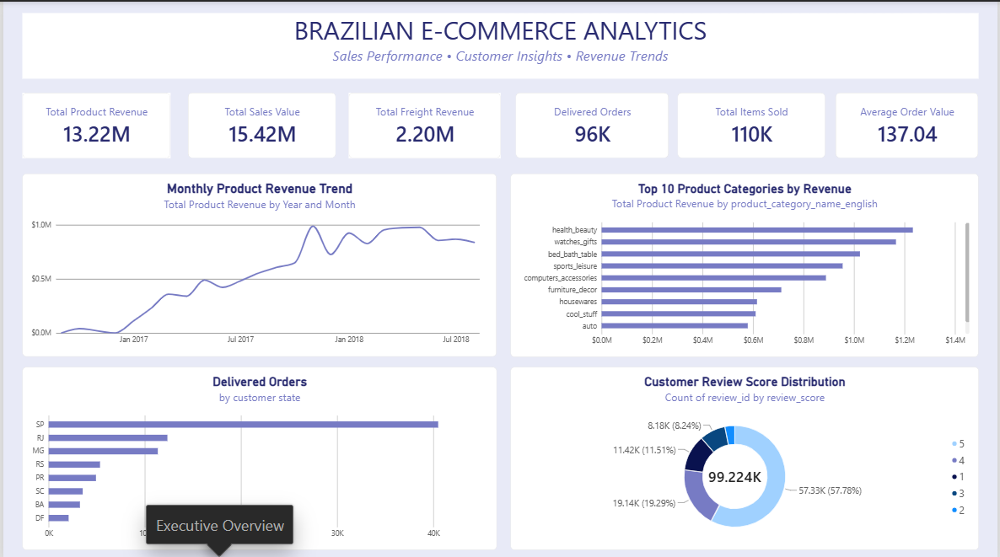
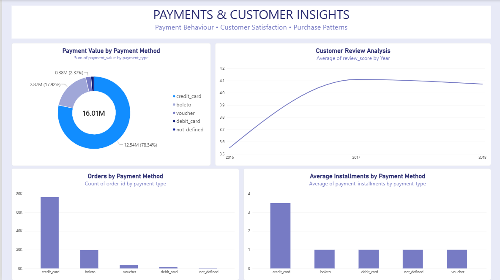

# Brazilian E-Commerce Analytics

An end-to-end data analytics project exploring Brazilian e-commerce performance using the Olist public dataset. This project combines Python, SQL, and Power BI to examine revenue trends, customer behaviour, product performance, payment patterns, and customer satisfaction.

## Project Overview

The objective of this project is to analyse e-commerce transaction data and identify meaningful business insights that can support better business decisions.

The analysis covers sales performance, customer purchasing patterns, seller performance, payment methods, delivery performance, and customer reviews.

## Business Questions

This project investigates the following questions:

- How has product revenue changed over time?
- Which product categories generate the highest revenue?
- Which Brazilian states contribute the most delivered orders?
- What percentage of customers make repeat purchases?
- Which payment methods are most commonly used?
- How do customers rate their shopping experiences?
- How does freight cost compare with product value?
- How concentrated is revenue among marketplace sellers?

## Tools and Technologies

| Tool | Purpose |
|---|---|
| Python | Data cleaning, exploratory data analysis, and business analysis |
| Pandas | Data manipulation and transformation |
| MySQL | SQL-based business analysis |
| Power BI | Interactive dashboards and visualisation |
| DAX | Calculated measures and KPIs |
| GitHub | Project documentation and version control |

## Project Structure

```text
Brazilian_Ecommerce_Analytics/
│
├── Dataset/
│   ├── olist_customers_dataset.csv
│   ├── olist_geolocation_dataset.csv
│   ├── olist_order_items_dataset.csv
│   ├── olist_order_payments_dataset.csv
│   ├── olist_order_reviews_dataset.csv
│   ├── olist_orders_dataset.csv
│   ├── olist_products_dataset.csv
│   ├── olist_sellers_dataset.csv
│   └── product_category_name_translation.csv
│
├── Python_Analysis/
│   ├── 01_dataset_exploration.py
│   ├── 02_business_analysis.py
│   ├── 03_prepare_reviews_for_mysql.py
│   ├── data_quality_report.csv
│   ├── duplicate_review_investigation.csv
│   ├── missing_value_report.csv
│   └── orders_analysis_ready.csv
│
├── SQL_Analysis/
│   ├── SQL_Queries/
│   ├── SQL_Screenshots/
│   └── SQL_Findings.md
│
├── Visualizations/
│   ├── category_performance.csv
│   ├── consumer_freight_analysis.csv
│   ├── consumer_freight_burden.png
│   ├── consumer_freight_summary.csv
│   ├── customer_order_analysis.csv
│   ├── monthly_revenue_trend.png
│   ├── monthly_sales_performance.csv
│   ├── price_demand_relationship.png
│   ├── price_freight_analysis.csv
│   ├── price_vs_freight.png
│   ├── seller_performance.csv
│   └── top_10_categories_revenue.png
│
├── Brazilian_Ecommerce_Analytics.pbix
└── README.md
```

**Note:** The Visualizations folder contains both exported analysis datasets and PNG charts. The interactive Power BI dashboards are maintained in the `.pbix` file.
```

## Key Business Findings

### Sales Performance
- Total product revenue from delivered orders: **R$13.22 million**
- Total freight value: **R$2.20 million**
- Total product and freight value: **R$15.42 million**
- Total delivered orders: **96,478**
- Average order value based on product revenue: **R$137.04**
- November 2017 recorded the highest monthly product revenue at approximately R$987,765.

### Product Performance
- Health & Beauty generated the highest product revenue at approximately R$1.23 million.
- Bed Bath & Table recorded the highest number of items sold.
- Watches & Gifts had the highest average item price among the ten highest-revenue categories.

### Customer Insights
- Approximately 93,358 unique customers had delivered orders.
- Only 3% of these customers made repeat purchases during the observed period.
- São Paulo accounted for approximately 42% of customers with delivered orders.

### Payment Behaviour
- Credit cards accounted for approximately 78.46% of total payment value.
- Boleto accounted for approximately 17.96%.
- Credit card payments had an average of 3.5 instalments.

### Customer Satisfaction
- Overall average review score: **4.09 out of 5**
- Approximately 77.07% of reviews were positive (4 or 5 stars).
- Approximately 14.69% were negative (1 or 2 stars).

### Freight Analysis
- Average freight value per delivered order: approximately R$22.79.
- Average freight share of combined product and freight value: approximately 30.84%.
- Around 55.48% of delivered orders had freight costs exceeding 20% of product value.

## 📊 Power BI Dashboard

The interactive Power BI dashboard presents sales performance, customer insights, payment behaviour and customer satisfaction across two pages.

### 1. Executive Overview



### 2. Payments & Customer Insights

This page explores:
## Dashboards

The Power BI report contains two analytical pages:

**1. Executive Overview**
- Revenue KPIs
- Monthly product revenue trends
- Top 10 product categories by revenue
- Delivered orders by customer state
- Customer review score distribution




**2. Payments & Customer Insights**
- Payment value by payment method
- Customer review analysis over time
- Orders by payment method
- Average payment instalments by payment method


**Download the Power BI dashboard:**  
[Brazilian_Ecommerce_Analytics.pbix](Brazilian_Ecommerce_Analytics.pbix)

## Methodology

The project followed a structured analytical workflow:

1. Data loading and initial inspection
2. Data quality assessment and cleaning
3. Exploratory data analysis using Python
4. Business analysis and statistical exploration
5. SQL querying and business insight extraction
6. Power BI dashboard development
7. Interpretation and documentation of findings

## Important Analytical Limitations

- The dataset covers a historical period from 2016 to 2018.
- Revenue represents product item value; freight is analysed separately.
- Product cost and operating cost data are unavailable, so profit and profit margin are not calculated.
- Repeat purchase analysis reflects the observed dataset period, not lifetime customer retention.
- Relationships between price and quantity are exploratory associations, not causal price elasticity estimates.
- Freight analysis does not establish that high freight costs caused customers to abandon purchases.

## Dataset Source and Attribution

Dataset: Brazilian E-Commerce Public Dataset by Olist.

The dataset is publicly available through Kaggle and contains anonymised e-commerce orders, customers, sellers, products, payments, and reviews.

Dataset licence: **CC BY-NC-SA 4.0**. Refer to the original dataset licence for attribution, non-commercial use, and share-alike requirements.

## Project Objective

This project demonstrates the application of data analytics techniques to a real-world e-commerce dataset, translating raw transactional data into business insights through Python, SQL, and Power BI.
